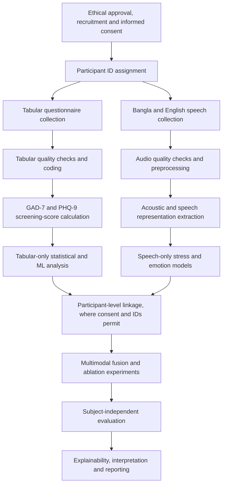
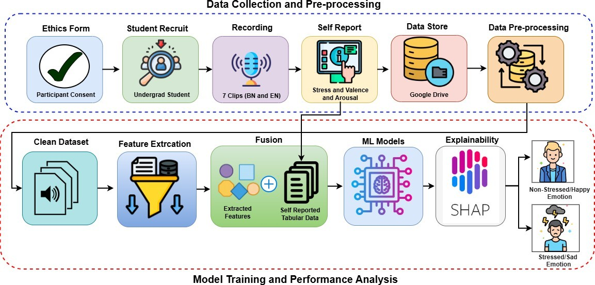
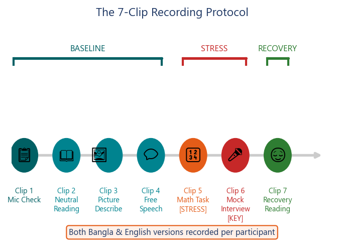
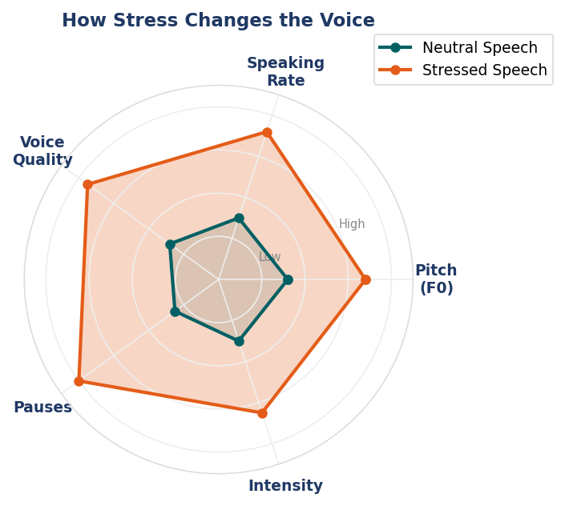
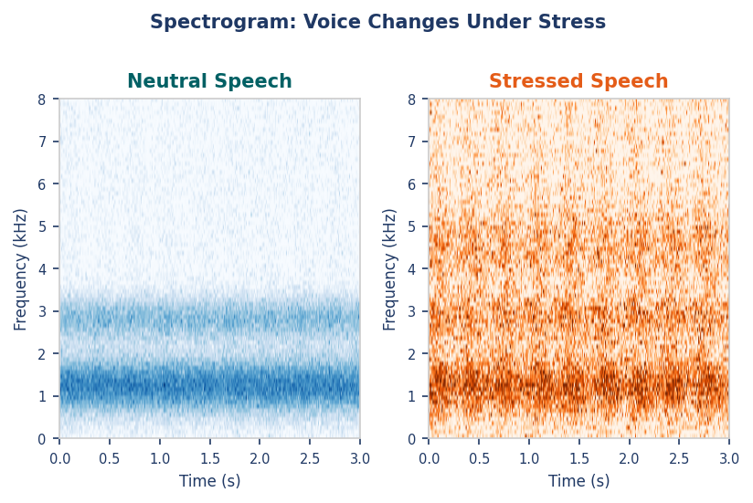
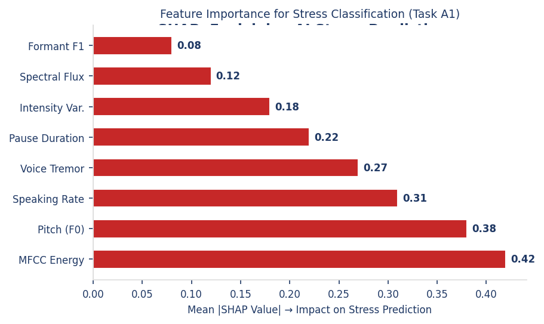
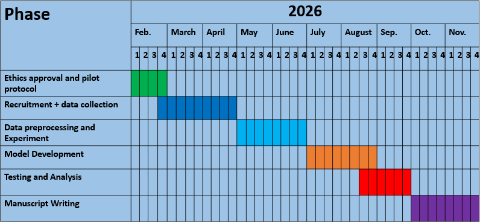
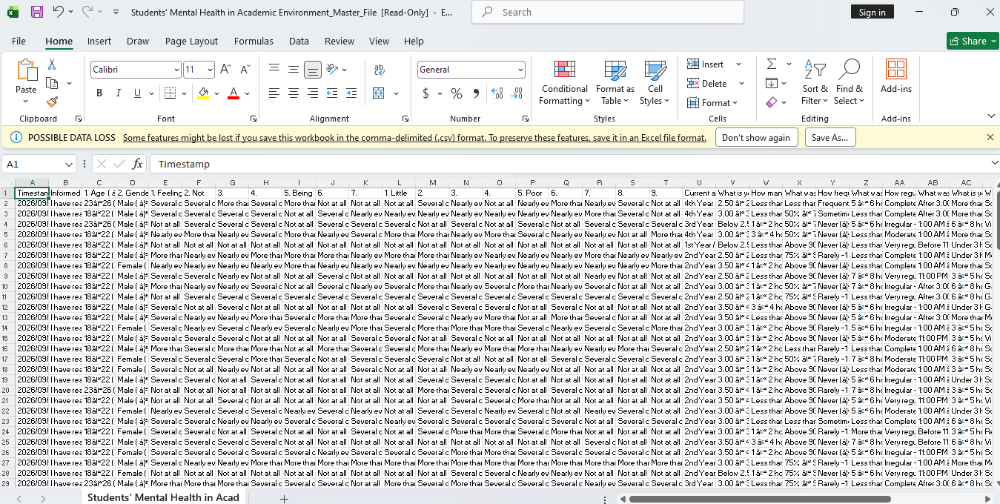

# Bilingual Speech-Based Stress and Emotion Detection in University Students

**A TSST-inspired bilingual (Bangla–English) speech research project with questionnaire-based mental-health and academic context**

[](https://uttarauniversity.edu.bd/)
[](#research-overview)
[](#current-project-status)

> **Research repository:** [monircse061/Bilingual-Speech-Based-Stress-Emotion-Detection](https://github.com/monircse061/Bilingual-Speech-Based-Stress-Emotion-Detection)

---

## 1. Research overview

This project investigates whether speech characteristics, together with student-reported mental-health and academic/lifestyle information, can support the study of stress and emotional states among university students in Bangladesh. The planned speech component focuses on Bangla and English and uses a short, controlled protocol inspired by established acute-stress paradigms, including the Trier Social Stress Test (TSST).

The research is designed as a **non-invasive research and screening-support pipeline**. It is intended to complement existing university counselling and student-support services, not to replace professional assessment or provide a clinical diagnosis.

The project combines two related research streams:

1. **Tabular questionnaire stream:** student demographics, GAD-7 anxiety items, PHQ-9 depression items, and self-reported academic and lifestyle indicators.
2. **Bilingual speech stream:** short Bangla and English speech recordings collected under neutral, task-based, stress-elicitation, and recovery conditions, subject to the approved protocol and participant consent.

The current repository contains project documentation and data-collection materials. Model performance results should be added only after the corresponding experiments have been completed and independently checked.

## 2. Project information

| Item | Description |
|---|---|
| Project title | Bilingual Speech-Based Stress and Emotion State Detection in University Students: A TSST-Inspired Voice Dataset with Tabular Context and Fusion Benchmarks |
| Institution | Uttara University, Bangladesh |
| Research unit | Center for Research and Training (CRT) |
| Project identification | CRT-UU-2026-13 |
| Principal Investigator | Md. Monir Ahammod Bin Atique |
| Co-Investigators | Dr Kamal Uddin Sarker; Md. Morshed Ali |
| Research area | Speech processing, machine learning, mental-health research, multimodal learning, explainable AI |
| Languages | Bangla and English |
| Current tabular collection | Approximately 400 student responses, as reported by the project team (21 November 2026) |
| Project period in mid-term report | 13 May 2026 – 19 March 2027 |

## 3. Motivation and research gap

University students may experience academic pressure, examinations, assignment deadlines, financial concerns, family responsibilities, irregular sleep, and other lifestyle challenges. Students do not always seek support when they first experience stress. This creates a need for research methods that can help universities understand student wellbeing at an aggregate level and investigate accessible signals associated with stress.

Questionnaires provide structured self-reports, but they do not capture vocal behaviour. Speech can contain acoustic and prosodic information such as pitch, intensity, speaking rate, pauses, and voice quality. However, models and datasets developed in other language and cultural settings may not generalize directly to Bangladeshi students or to Bangla–English bilingual speech.

This project therefore investigates a context-sensitive combination of questionnaire data and bilingual speech. The research questions are:

- **RQ1:** Are existing university Mental Health Units alone sufficient for effective monitoring and early detection of student stress and emotional wellbeing at scale?
- **RQ2:** What is the relationship between stress levels and voice patterns, and can these patterns distinguish stress from neutral states?
- **RQ3:** Can emotion dimensions (valence and arousal) be estimated from speech, and does adding tabular context improve performance?
- **RQ4:** How does language (Bangla versus English) affect acoustic markers and model generalization?

## 4. Research objectives

1. Develop a bilingual Bangla–English student speech dataset using a standardized, safe, and repeatable acute-stress-inspired protocol, with repeated self-reports.
2. Build baseline models using acoustic features and self-supervised speech representations.
3. Evaluate whether combining speech representations with tabular context improves performance compared with speech-only models.
4. Document the dataset, quality-control procedures, and reproducible evaluation pipeline.
5. Investigate model explanations to understand which acoustic and contextual features contribute to predictions.

## 5. Data collection

### 5.1 Tabular questionnaire dataset

As of **21 November 2026**, the project team reports that approximately **400 student questionnaire responses** have been collected. This is the current collection count reported by the team; it is not a claim that all records have already passed final eligibility, quality-control, or analysis checks.

The bilingual Google Forms instrument includes the following sections:

| Section | Variables |
|---|---|
| Consent | Voluntary participation and age/consent confirmation |
| Demographics | Age category and gender |
| Anxiety | Seven GAD-7 items |
| Depression | Nine PHQ-9 items |
| Academic profile | Current academic year and approximate CGPA range |
| Study habits | Daily self-study hours, attendance, late or missed assignments |
| Sleep | Sleep duration, sleep regularity, and typical bedtime |
| Digital habits | Smartphone screen time, device-use purpose, and screen use before sleep |
| Lifestyle and social context | Exercise, caffeine intake, meal regularity, living arrangement, and in-person social interaction |
| Other contextual factors | Financial stress, extracurricular participation, and perceived academic workload |

The questionnaire uses four frequency responses for GAD-7 and PHQ-9 items: **Not at all**, **Several days**, **More than half the days**, and **Nearly every day**.

**Important:** GAD-7 and PHQ-9 scores are screening measures. Their score bands must not be described as clinical diagnoses. Academic and lifestyle variables are self-reported categories, not verified university records.

### 5.2 Speech dataset: planned protocol

The approved research proposal describes recruiting university students, obtaining informed consent, and recording both Bangla and English speech. Each participant is expected to complete seven short recording tasks in each language, with language order counterbalanced where practical.

| Clip | Task | Approximate duration |
|---|---|---:|
| 1 | Microphone check: read a fixed sentence | 10–15 seconds |
| 2 | Neutral reading passage | 45–60 seconds |
| 3 | Standardized picture description | 30–45 seconds |
| 4 | Free speech about a routine day or recent class experience | 45–60 seconds |
| 5 | Gentle time-pressured mental arithmetic | 30–45 seconds |
| 6 | TSST-style mock interview or scholarship pitch | 90–120 seconds |
| 7 | Recovery reading with slow-breathing instruction | 45–60 seconds |

After each clip, the protocol proposes collecting self-reported stress intensity (0–100) and emotion ratings such as valence and arousal. The tasks are intended to be mild, non-invasive, and reversible, followed by participant debriefing.

**Collection-status note:** The CRT mid-term report recorded three preliminary voice samples at the time of that report and stated that the audio set was not yet sufficient for model evaluation. The project team should update this README when the current number of eligible, quality-checked Bangla and English recordings is verified. The approximately 400 questionnaire responses must not be interpreted as 400 paired speech participants.

### 5.3 Recording setup and quality control

The proposal specifies the following recording practices:

- Use a quiet laboratory or meeting room with reduced background noise.
- Use a USB cardioid or headset microphone with a pop filter, keeping the microphone approximately 15 cm from the participant.
- Record mono WAV audio, preferably 16-bit PCM at 16 kHz, or record at 44.1 kHz and downsample consistently.
- Keep recording gain consistent and avoid clipping.
- Record a short microphone-check sample before the tasks.
- Replay recordings after capture, document noise or interruption events, and repeat a clip only when justified by the protocol.
- Use participant ID codes rather than names in research files.

## 6. Proposed methodology

The research pipeline has two data branches that are prepared separately and are linked only when valid participant-level identifiers and consent allow it.



### Stage 1 — Participant recruitment and data collection

Participants are recruited from the university student population under the applicable ethical approval. Consent is obtained before data collection. The questionnaire and speech protocol are documented as separate collection instruments. Speech recordings are linked to questionnaire records only through pseudonymous participant identifiers and only when the approved consent and protocol permit this linkage.

### Stage 2 — Tabular data preprocessing

The questionnaire dataset will be checked for:

- Duplicate submissions and invalid or ineligible records.
- Consent status and age eligibility.
- Missing, inconsistent, or out-of-range values.
- Consistent coding of categorical and ordinal responses.
- Correct mapping of GAD-7 and PHQ-9 response options to scores from 0 to 3 per item.
- Correct total-score calculation and screening-band assignment.

For descriptive reporting, GAD-7 total scores range from 0 to 21 and PHQ-9 total scores range from 0 to 27. Screening bands should follow the scoring conventions selected in the finalized analysis plan. Any records requiring eligibility review should be resolved before the final analysis.

### Stage 3 — Audio preprocessing and feature extraction

The proposed audio pipeline includes silence trimming, loudness normalization, clip-level segmentation, and optional voice activity detection. Candidate representations include:

- **Acoustic features:** MFCCs, pitch/fundamental frequency, energy/intensity, speaking rate, pauses, and eGeMAPS-style prosodic and spectral descriptors.
- **Deep speech representations:** self-supervised embeddings from wav2vec 2.0 or WavLM-family models.
- **Language and task metadata:** Bangla/English condition and clip/task type, where available and appropriate.

### Stage 4 — Model development

The proposal identifies the following candidate approaches:

| Task | Candidate methods |
|---|---|
| Tabular baseline | Logistic Regression, SVM, tree-based machine-learning models |
| Speech acoustic baseline | Logistic Regression, SVM, XGBoost |
| Spectrogram-based model | CNN or CNN–LSTM using log-Mel representations |
| Pretrained speech model | wav2vec 2.0 / WavLM representations or fine-tuning where feasible |
| Multimodal fusion | Concatenate pooled speech embeddings and tabular features, followed by an MLP |

The primary speech task is **binary stress versus neutral classification**. A secondary task is estimating **valence and arousal** as continuous emotion dimensions.

The tabular questionnaire analysis of anxiety and depression is a complementary analysis stream. It should not be silently treated as the same label as speech-derived acute stress.

### Stage 5 — Multimodal fusion

The fusion experiment will compare:

1. Tabular-only models.
2. Speech-only models.
3. Combined speech-plus-tabular models.

Fusion will be performed only for records with valid participant-level linkage and suitable consent. Performance comparisons should use the same eligible participant groups and data partitions wherever possible.

### Stage 6 — Evaluation and explainability

The proposal specifies subject-independent evaluation, using participant-level GroupKFold or an equivalent grouped split. Clips from the same participant must not be distributed across training and test partitions. This reduces the risk of participant leakage.

Planned evaluation measures include:

- **Stress classification:** accuracy and macro F1-score; additional class-wise precision, recall, confusion matrix, and ROC-AUC may be reported where appropriate.
- **Valence/arousal estimation:** Concordance Correlation Coefficient (CCC) and Mean Absolute Error (MAE).
- **Ablation analysis:** Bangla versus English, baseline versus stressor/recovery clips, and speech-only versus fusion.
- **Explainability:** SHAP global feature importance and local feature contributions for suitable models.

No model performance values are reported in this README because the supplied project progress report states that finalized statistical/ML modelling and evaluation had not yet started at that reporting stage.

## 7. Current project status

| Component | Status |
|---|---|
| Research proposal and protocol | Prepared |
| Bilingual questionnaire | Prepared and used |
| Tabular questionnaire collection | Approximately 400 responses reported by the team on 21 November 2026 |
| Tabular cleaning and score validation | Requires final verification on the latest dataset |
| Speech protocol | Specified in the proposal |
| Speech recording collection | Preliminary collection was reported in the earlier mid-term report; current total needs updating |
| Audio feature extraction | Not confirmed as completed |
| Statistical and ML modelling | No finalized results documented in the supplied mid-term report |
| Speech–tabular fusion | Pending eligible paired data and modelling |
| Explainability and final evaluation | Planned |

### Earlier reported progress (mid-term report)

The CRT mid-term report documented **135 questionnaire records across 39 fields** and **three preliminary voice samples** at the time of submission. It also reported first-pass GAD-7 and PHQ-9 scoring and explicitly stated that no trained model results or final conclusions were being claimed.

The current project-team update of approximately 400 questionnaire responses supersedes the earlier collection count for the README's current-status summary. The earlier score distributions should not be reused as results for the newer 400-response dataset.

## 8. Figures and project materials

The following figures are extracted from the project's **CRT Research Presentation**. They are included to explain the proposed research design and workflow. Conceptual illustrations are not experimental findings.

### 8.1 Overall data collection and modelling pipeline



*Figure 1. The presentation's end-to-end workflow, from participant consent and recruitment through recording, self-report, data storage, preprocessing, feature extraction, fusion, modelling, and explainability.*

### 8.2 Seven-clip bilingual recording protocol



*Figure 2. The seven recording tasks grouped into baseline, stress, and recovery stages. The presentation specifies that Bangla and English versions are recorded for each participant.*

### 8.3 Conceptual voice characteristics under stress



*Figure 3. A conceptual illustration of possible changes in pitch, speaking rate, voice quality, pauses, and intensity. This is an explanatory figure, not a result calculated from the project's collected recordings.*

### 8.4 Illustrative speech spectrogram comparison



*Figure 4. Example spectrogram-style visualization used in the presentation to explain how speech signals may differ. It should not be interpreted as a spectrogram generated from the project's student recordings unless the original signal provenance is verified.*

### 8.5 Feature-importance illustration



*Figure 5. The feature-importance graphic shown in the presentation. The values are retained as a presentation illustration only; they are not reported as trained-model or SHAP results from the current project. Replace this figure with a plot generated from the final, participant-independent experiments before making empirical claims.*

### 8.6 Project timeline



*Figure 6. The planned project phases shown in the presentation, including ethics and pilot work, recruitment and data collection, preprocessing, model development, testing, analysis, and manuscript writing. Update the timeline if the approved project schedule has changed.*

### 8.7 Tabular data collection screenshot

The following screenshot illustrates the tabular data collection spreadsheet. The visible screenshot is included for documentation only; it is not the raw dataset.



### Project documents

The repository currently includes project documentation and supporting materials such as:

- CRT research grant application and proposal.
- CRT mid-term progress report.
- Research presentation in PDF and PowerPoint formats.
- Data-collection schedule image.
- Student mental-health questionnaire form.
- Student mental-health report.

As code, analysis notebooks, and verified result figures become available, add them to clearly named folders and update this README.

## 9. Repository organization

The repository will serve as a documentation and project-material repository (still working on the project). A prospective structure for the next development stage is:

```text
Bilingual-Speech-Based-Stress-Emotion-Detection/
│
├── README.md
├── docs/
│   ├── CRT_Research_Grant_Application.pdf
│   ├── CRT_Mid_Term_Progress_Report.pdf
│   └── Research_Presentation.pdf
│
├── assets/
│   ├── data_collection_progress.png
│   ├── methodology_pipeline.jpg
│   ├── seven_clip_protocol.png
│   ├── voice_stress_concept.png
│   ├── speech_spectrogram_concept.png
│   ├── illustrative_feature_importance.png
│   ├── project_timeline.png
│   └── results/
│
├── data/
│   ├── README.md
│   └── (restricted or approved de-identified data only)
│
├── notebooks/
│   ├── 01_tabular_data_quality.ipynb
│   ├── 02_questionnaire_scoring_eda.ipynb
│   ├── 03_tabular_baselines.ipynb
│   ├── 04_audio_preprocessing.ipynb
│   └── 05_speech_tabular_fusion.ipynb
│
├── src/
│   ├── preprocessing/
│   ├── features/
│   ├── models/
│   ├── evaluation/
│   └── explainability/
│
├── results/
│   ├── figures/
│   └── tables/
│
├── requirements.txt
└── LICENSE
```

This is a **recommended future structure**, not a claim that all these folders or scripts already exist.

## 10. Data access, privacy, and ethical use

Mental-health questionnaire responses and voice recordings are sensitive research data. Do not upload raw identifiable responses, participant names, contact information, unredacted consent records, or identifiable audio recordings to a public GitHub repository.

Before releasing any dataset:

- Confirm that public sharing is covered by the relevant ethical approval and participant consent.
- Remove direct identifiers and review indirect-identification risks.
- Store the working dataset in approved, access-controlled institutional storage.
- Publish only aggregate statistics or appropriately de-identified data approved for release.
- Keep participant ID linkage files separate from research features.
- Document any data access restrictions and a contact process for legitimate research requests.

The outputs of this research are for research and screening-support purposes. They must not be used as a substitute for diagnosis, counselling, or professional mental-health care. A model prediction must not be used alone to make decisions about an individual student.

## 11. Reproducibility and future work

The next development steps are:

1. Export the latest questionnaire responses to a secure CSV/XLSX file and preserve an unchanged raw-data copy in restricted storage.
2. Create a data dictionary describing each field, allowed values, missing-value codes, and scoring rules.
3. Verify the approximately 400 records, including consent, eligibility, duplicates, and completeness.
4. Recalculate GAD-7 and PHQ-9 scores for the current verified dataset.
5. Report descriptive statistics and exploratory relationships with academic and lifestyle variables.
6. Continue speech collection under the approved bilingual protocol and document the number of valid recordings by participant, language, and clip.
7. Extract acoustic and pretrained speech features.
8. Establish participant-independent baselines and compare tabular-only, speech-only, and fusion approaches.
9. Add validated metrics, plots, confusion matrices, and SHAP explanations after experiments are complete.
10. Prepare a technical report and manuscript with clear limitations.

## 12. Citation and acknowledgement

If you use or refer to this project, please cite the project team and the repository:

> Ahammod Bin Atique, M., Sarker, K. U., and Ali, M. *Bilingual Speech-Based Stress and Emotion State Detection in University Students: A TSST-Inspired Voice Dataset with Tabular Context and Fusion Benchmarks*. Center for Research and Training, Uttara University, Bangladesh. Project CRT-UU-2026-13.

Please update this citation if the project authorship, title, or institutional details change in the final publication.

## 13. Contact

**Principal Investigator:** Md. Monir Ahammod Bin Atique  
**Affiliation:** Department of Computer Science and Engineering, Uttara University, Bangladesh  
**Email:** atique.cse@uttarauniversity.edu.bd

For project collaboration, dataset documentation, or research-related questions, please contact the Principal Investigator.

---

*Last documentation update: 21 November 2026. The approximate current questionnaire count is based on the project team's update; the latest raw response file was not included in the materials used to prepare this README.*
